# Data Dictionary & Entity-Relationship Documentation

## Customer Complaint Management & SLA Tracking System
**Phase 2: Database Design & Data Models**

This document provides a comprehensive specification of the database architecture, entity relationships, constraints, indexes, and field definitions.

---

## 1. Entity-Relationship (ER) Diagram

The following Mermaid diagram illustrates the 16 core entities, bridge tables, and historical audit logs.

```mermaid
erDiagram
    CUSTOMERS ||--o{ ORDERS : "places"
    CUSTOMERS ||--o{ COMPLAINTS : "submits"
    CUSTOMERS ||--o{ SURVEYS : "submits"
    CATEGORIES ||--o{ CATEGORIES : "parent of"
    CATEGORIES ||--o{ PRODUCTS : "classifies"
    CATEGORIES ||--o{ PRIORITY_RULES : "governs"
    CATEGORIES ||--o{ COMPLAINTS : "categorizes"
    PRODUCTS ||--o{ ORDER_ITEMS : "included in"
    PRODUCTS ||--o{ COMPLAINTS : "referenced in"
    ORDERS ||--|{ ORDER_ITEMS : "contains"
    ORDERS ||--o{ COMPLAINTS : "referenced in"
    AGENTS ||--o{ ASSIGNMENTS : "assigned to"
    AGENTS ||--o{ RESOLUTIONS : "resolves"
    COMPLAINTS ||--o{ COMPLAINT_MESSAGES : "contains conversation"
    COMPLAINTS ||--o{ ASSIGNMENTS : "tracks agent ownership"
    COMPLAINTS ||--o{ COMPLAINT_STATUS_HISTORY : "tracks status changes"
    COMPLAINTS ||--o{ COMPLAINT_REOPEN_HISTORY : "tracks reopen events"
    COMPLAINTS ||--|| SLA_CLOCKS : "timed by"
    SLA_CLOCKS ||--o{ SLA_EVENTS : "records clock events"
    COMPLAINTS ||--o{ RESOLUTIONS : "resolved by"
    COMPLAINTS ||--o| SURVEYS : "evaluated by"

    CUSTOMERS {
        string id PK "CUS-000001"
        string first_name
        string last_name
        string email UK
        string phone
        string company_name
        string tier "Standard|Premium|Enterprise|VIP"
        string status "Active|Inactive|Suspended"
    }

    PRODUCTS {
        string id PK "PRD-000001"
        string sku UK
        string name
        string category_id FK
        numeric unit_price
        string status "Active|Discontinued|OutOfStock"
    }

    ORDERS {
        string id PK "ORD-2026-000001"
        string customer_id FK
        datetime order_date
        string order_status
        numeric total_amount
    }

    ORDER_ITEMS {
        integer id PK
        string order_id FK
        string product_id FK
        integer quantity
        numeric unit_price
        numeric total_price
    }

    AGENTS {
        string id PK "AGT-000001"
        string first_name
        string last_name
        string email UK
        string team
        string role "Support Agent|Senior Specialist|Team Lead|Manager"
        integer max_active_tickets
        boolean is_active
    }

    CATEGORIES {
        string id PK "CAT-000001"
        string name UK
        string slug UK
        string parent_category_id FK
        string default_priority "Critical|High|Medium|Low"
        boolean is_active
    }

    PRIORITY_RULES {
        string id PK "RUL-000001"
        string name UK
        string category_id FK
        string customer_tier
        string keyword_trigger
        string target_priority
        numeric sla_target_hours
        boolean is_active
    }

    COMPLAINTS {
        string id PK "CMP-2026-000001"
        string customer_id FK
        string order_id FK
        string product_id FK
        string category_id FK
        string title
        text description
        string channel "Web|Email|Phone|Chat|Mobile"
        string priority "Critical|High|Medium|Low"
        string status "New|Assigned|In Progress|Pending Customer|Pending Vendor|Resolved|Closed|Reopened"
        integer reopen_count
    }

    COMPLAINT_MESSAGES {
        string id PK "MSG-CMP-2026-000001-001"
        string complaint_id FK
        integer sequence_number
        string sender_type "Customer|Agent|System"
        string sender_id
        string sender_name
        text message_body
        boolean is_internal_note
    }

    ASSIGNMENTS {
        string id PK "ASN-CMP-2026-000001-001"
        string complaint_id FK
        string agent_id FK
        integer sequence_number
        string assigned_by
        string assignment_reason
        boolean is_current
    }

    COMPLAINT_STATUS_HISTORY {
        integer id PK
        string complaint_id FK
        string from_status
        string to_status
        string changed_by
        text reason
        datetime changed_at
    }

    COMPLAINT_REOPEN_HISTORY {
        integer id PK
        string complaint_id FK
        integer reopen_sequence
        string previous_resolution_id FK
        string reopened_by
        text reopen_reason
    }

    SLA_CLOCKS {
        string id PK "SLA-CMP-2026-000001"
        string complaint_id FK,UK
        integer target_duration_minutes
        integer elapsed_active_minutes
        integer elapsed_paused_minutes
        string clock_state "Running|Paused|Stopped|Breached"
        datetime start_time
        datetime deadline
        boolean is_breached
    }

    SLA_EVENTS {
        integer id PK
        string sla_clock_id FK
        string event_type "Started|Paused|Resumed|Stopped|Breached|Adjusted"
        string reason
        string triggered_by
        datetime event_time
    }

    RESOLUTIONS {
        string id PK "RES-CMP-2026-000001"
        string complaint_id FK
        integer attempt_number
        string resolved_by_agent_id FK
        string root_cause
        text action_taken
        string resolution_type
        boolean is_accepted_by_customer
    }

    SURVEYS {
        string id PK "SRV-CMP-2026-000001"
        string complaint_id FK,UK
        string customer_id FK
        integer rating "1-5"
        integer nps_score "0-10"
        string satisfaction_level
        text feedback_comments
    }
```

---

## 2. Deterministic Identifier Conventions

| Entity | Format Pattern | Example | Description |
| :--- | :--- | :--- | :--- |
| **Customer** | `CUS-######` | `CUS-000001` | Sequential 6-digit zero-padded customer identifier. |
| **Order** | `ORD-YYYY-######` | `ORD-2026-000001` | Year prefix with sequential 6-digit order identifier. |
| **Complaint** | `CMP-YYYY-######` | `CMP-2026-000001` | Year prefix with sequential 6-digit complaint ticket identifier. |
| **ComplaintMessage** | `MSG-<complaint-id>-###` | `MSG-CMP-2026-000001-001` | Linked to complaint with 3-digit message sequence number. |
| **Assignment** | `ASN-<complaint-id>-###` | `ASN-CMP-2026-000001-001` | Linked to complaint with 3-digit assignment sequence. |
| **SLAClock** | `SLA-<complaint-id>` | `SLA-CMP-2026-000001` | Exactly one SLA clock per complaint ticket. |
| **Resolution** | `RES-<complaint-id>[-##]` | `RES-CMP-2026-000001` | Primary attempt, or `-02` for reopened resolution attempts. |
| **Survey** | `SRV-<complaint-id>` | `SRV-CMP-2026-000001` | Exactly one customer survey per resolved complaint. |
| **Agent** | `AGT-######` | `AGT-000001` | Sequential 6-digit support agent identifier. |
| **Product** | `PRD-######` | `PRD-000001` | Sequential 6-digit product SKU identifier. |
| **Category** | `CAT-######` | `CAT-000001` | Sequential 6-digit category code. |
| **PriorityRule** | `RUL-######` | `RUL-000001` | Sequential 6-digit automated triage rule identifier. |

---

## 3. Data Dictionary: Detailed Table Specifications

### 3.1. `customers` Table
Represents registered customers and organizations submitting complaints.

| Column | Type | Nullable | Key / Constraint | Description |
| :--- | :--- | :--- | :--- | :--- |
| `id` | `VARCHAR(30)` | No | **PK** | Formatted ID (`CUS-000001`). |
| `first_name` | `VARCHAR(100)` | No | None | Customer given name. |
| `last_name` | `VARCHAR(100)` | No | None | Customer surname. |
| `email` | `VARCHAR(255)` | No | **UNIQUE, INDEX** | Primary contact email. |
| `phone` | `VARCHAR(30)` | Yes | None | Contact phone number. |
| `company_name` | `VARCHAR(150)` | Yes | None | Organization/Company name (B2B customers). |
| `tier` | `VARCHAR(50)` | No | `CHECK IN ('Standard', 'Premium', 'Enterprise', 'VIP')` | Default: `'Standard'`. Influences SLA priority. |
| `status` | `VARCHAR(20)` | No | `CHECK IN ('Active', 'Inactive', 'Suspended')` | Default: `'Active'`. |
| `created_at` | `DATETIME` | No | Default: UTC Now | Account creation timestamp. |
| `updated_at` | `DATETIME` | No | Default: UTC Now | Last account update timestamp. |

- **Relationships:**
  - One-to-Many with `orders` (`customer_id`)
  - One-to-Many with `complaints` (`customer_id`)
  - One-to-Many with `surveys` (`customer_id`)

---

### 3.2. `agents` Table
Represents customer service representatives and support specialists.

| Column | Type | Nullable | Key / Constraint | Description |
| :--- | :--- | :--- | :--- | :--- |
| `id` | `VARCHAR(30)` | No | **PK** | Formatted ID (`AGT-000001`). |
| `first_name` | `VARCHAR(100)` | No | None | Agent given name. |
| `last_name` | `VARCHAR(100)` | No | None | Agent family name. |
| `email` | `VARCHAR(255)` | No | **UNIQUE, INDEX** | Agent corporate email. |
| `phone` | `VARCHAR(30)` | Yes | None | Extension or phone. |
| `team` | `VARCHAR(100)` | No | **INDEX** | Team (e.g. `'Tier 1 Support'`, `'Billing Operations'`). |
| `role` | `VARCHAR(50)` | No | `CHECK IN ('Support Agent', 'Senior Specialist', 'Team Lead', 'Manager')` | Role seniority level. |
| `max_active_tickets` | `INTEGER` | No | `CHECK (max_active_tickets > 0)` | Default: `10`. Ticket concurrency limit. |
| `is_active` | `BOOLEAN` | No | Default: `TRUE` | Whether the agent is available for triage. |
| `created_at` | `DATETIME` | No | Default: UTC Now | Agent record creation timestamp. |
| `updated_at` | `DATETIME` | No | Default: UTC Now | Last profile update timestamp. |

- **Relationships:**
  - One-to-Many with `assignments` (`agent_id`)
  - One-to-Many with `resolutions` (`resolved_by_agent_id`)

---

### 3.3. `categories` Table
Categorizes complaints and products into functional departments.

| Column | Type | Nullable | Key / Constraint | Description |
| :--- | :--- | :--- | :--- | :--- |
| `id` | `VARCHAR(30)` | No | **PK** | Formatted ID (`CAT-000001`). |
| `name` | `VARCHAR(100)` | No | **UNIQUE** | Category display name. |
| `slug` | `VARCHAR(100)` | No | **UNIQUE, INDEX** | URL/lookup slug (`billing-inquiries`). |
| `description` | `VARCHAR(255)` | Yes | None | Category scope description. |
| `parent_category_id` | `VARCHAR(30)` | Yes | **FK (`categories.id`)** | Self-referencing FK for subcategories. |
| `default_priority` | `VARCHAR(20)` | No | `CHECK IN ('Critical', 'High', 'Medium', 'Low')` | Default priority fallback. |
| `is_active` | `BOOLEAN` | No | Default: `TRUE` | Category availability toggle. |
| `created_at` | `DATETIME` | No | Default: UTC Now | Creation timestamp. |
| `updated_at` | `DATETIME` | No | Default: UTC Now | Update timestamp. |

- **Relationships:**
  - Self-referential hierarchy (`parent_category_id` -> `categories.id`)
  - One-to-Many with `complaints` (`category_id`)
  - One-to-Many with `priority_rules` (`category_id`)

---

### 3.4. `products` Table
Catalog of goods and services associated with customer complaints.

| Column | Type | Nullable | Key / Constraint | Description |
| :--- | :--- | :--- | :--- | :--- |
| `id` | `VARCHAR(30)` | No | **PK** | Formatted ID (`PRD-000001`). |
| `sku` | `VARCHAR(50)` | No | **UNIQUE, INDEX** | Stock Keeping Unit code. |
| `name` | `VARCHAR(150)` | No | None | Product title/name. |
| `description` | `TEXT` | Yes | None | Extended product description. |
| `category_id` | `VARCHAR(30)` | Yes | **FK (`categories.id`)** | Product family category. |
| `unit_price` | `NUMERIC(10,2)` | No | `CHECK (unit_price >= 0)` | Product retail price. |
| `status` | `VARCHAR(20)` | No | `CHECK IN ('Active', 'Discontinued', 'OutOfStock')` | Catalog availability status. |
| `created_at` | `DATETIME` | No | Default: UTC Now | Creation timestamp. |
| `updated_at` | `DATETIME` | No | Default: UTC Now | Update timestamp. |

- **Relationships:**
  - Many-to-One with `categories` (`category_id`)
  - One-to-Many with `order_items` (`product_id`)
  - One-to-Many with `complaints` (`product_id`)

---

### 3.5. `orders` Table
Purchase transactions placed by customers.

| Column | Type | Nullable | Key / Constraint | Description |
| :--- | :--- | :--- | :--- | :--- |
| `id` | `VARCHAR(30)` | No | **PK** | Formatted ID (`ORD-2026-000001`). |
| `customer_id` | `VARCHAR(30)` | No | **FK (`customers.id`), INDEX** | Purchasing customer. |
| `order_date` | `DATETIME` | No | Default: UTC Now | Order placement timestamp. |
| `order_status` | `VARCHAR(30)` | No | `CHECK IN ('Pending', 'Processing', 'Completed', 'Cancelled', 'Refunded')` | Current order status. |
| `total_amount` | `NUMERIC(12,2)` | No | `CHECK (total_amount >= 0)` | Total transaction value. |
| `shipping_address` | `TEXT` | Yes | None | Delivery destination address. |
| `created_at` | `DATETIME` | No | Default: UTC Now | Creation timestamp. |
| `updated_at` | `DATETIME` | No | Default: UTC Now | Update timestamp. |

- **Relationships:**
  - Many-to-One with `customers` (`customer_id`)
  - One-to-Many with `order_items` (`order_id`) (Bridge table)
  - One-to-Many with `complaints` (`order_id`)

---

### 3.6. `order_items` Table (Bridge Table: Many-to-Many)
Bridge table implementing the Many-to-Many relationship between `orders` and `products`.

| Column | Type | Nullable | Key / Constraint | Description |
| :--- | :--- | :--- | :--- | :--- |
| `id` | `INTEGER` | No | **PK, AUTOINCREMENT** | Line item record ID. |
| `order_id` | `VARCHAR(30)` | No | **FK (`orders.id` ON DELETE CASCADE), INDEX** | Associated order. |
| `product_id` | `VARCHAR(30)` | No | **FK (`products.id`), INDEX** | Associated product. |
| `quantity` | `INTEGER` | No | `CHECK (quantity > 0)` | Purchased quantity. |
| `unit_price` | `NUMERIC(10,2)` | No | `CHECK (unit_price >= 0)` | Price at transaction time. |
| `total_price` | `NUMERIC(10,2)` | No | `CHECK (total_price >= 0)` | Computed line total (`quantity * unit_price`). |

- **Constraints:** `UNIQUE(order_id, product_id)`

---

### 3.7. `priority_rules` Table
Rules engine configuration mapping customer tiers, categories, and triggers to SLA targets.

| Column | Type | Nullable | Key / Constraint | Description |
| :--- | :--- | :--- | :--- | :--- |
| `id` | `VARCHAR(30)` | No | **PK** | Formatted ID (`RUL-000001`). |
| `name` | `VARCHAR(150)` | No | **UNIQUE** | Rule identifier name. |
| `category_id` | `VARCHAR(30)` | Yes | **FK (`categories.id`), INDEX** | Target category filter. |
| `customer_tier` | `VARCHAR(50)` | Yes | None | Customer tier filter (`Enterprise`, etc.). |
| `keyword_trigger` | `VARCHAR(255)` | Yes | None | Natural language trigger terms. |
| `target_priority` | `VARCHAR(20)` | No | `CHECK IN ('Critical', 'High', 'Medium', 'Low')` | Priority outcome. |
| `sla_target_hours` | `NUMERIC(6,2)` | No | `CHECK (sla_target_hours > 0)` | Target resolution SLA in hours. |
| `is_active` | `BOOLEAN` | No | Default: `TRUE` | Active rule evaluation flag. |
| `created_at` | `DATETIME` | No | Default: UTC Now | Creation timestamp. |
| `updated_at` | `DATETIME` | No | Default: UTC Now | Update timestamp. |

---

### 3.8. `complaints` Table
Central entity representing customer grievance tickets.

| Column | Type | Nullable | Key / Constraint | Description |
| :--- | :--- | :--- | :--- | :--- |
| `id` | `VARCHAR(30)` | No | **PK** | Formatted ID (`CMP-2026-000001`). |
| `customer_id` | `VARCHAR(30)` | No | **FK (`customers.id`), INDEX** | Customer submitting ticket. |
| `order_id` | `VARCHAR(30)` | Yes | **FK (`orders.id`), INDEX** | Optional related order. |
| `product_id` | `VARCHAR(30)` | Yes | **FK (`products.id`), INDEX** | Optional related product. |
| `category_id` | `VARCHAR(30)` | No | **FK (`categories.id`), INDEX** | Complaint category. |
| `title` | `VARCHAR(255)` | No | None | Short summary of the complaint. |
| `description` | `TEXT` | No | None | Detailed grievance narrative. |
| `channel` | `VARCHAR(50)` | No | `CHECK IN ('Web', 'Email', 'Phone', 'Chat', 'Mobile')` | Ingestion channel. |
| `priority` | `VARCHAR(20)` | No | `CHECK IN ('Critical', 'High', 'Medium', 'Low')` | SLA severity level. |
| `status` | `VARCHAR(30)` | No | `CHECK IN ('New', 'Assigned', 'In Progress', 'Pending Customer', 'Pending Vendor', 'Resolved', 'Closed', 'Reopened')` | Ticket lifecycle state. |
| `reopen_count` | `INTEGER` | No | `CHECK (reopen_count >= 0)` | Default: `0`. Times ticket was reopened. |
| `created_at` | `DATETIME` | No | Default: UTC Now | Ticket submission timestamp. |
| `updated_at` | `DATETIME` | No | Default: UTC Now | Last activity timestamp. |

- **Relationships:**
  - One-to-Many with `complaint_messages`
  - One-to-Many with `assignments`
  - One-to-Many with `complaint_status_history`
  - One-to-Many with `complaint_reopen_history`
  - One-to-One with `sla_clocks`
  - One-to-Many with `resolutions`
  - One-to-One with `surveys`

---

### 3.9. `complaint_messages` Table (Message History)
Chronological thread of communications between customer, agent, and system.

| Column | Type | Nullable | Key / Constraint | Description |
| :--- | :--- | :--- | :--- | :--- |
| `id` | `VARCHAR(100)` | No | **PK** | Formatted ID (`MSG-CMP-2026-000001-001`). |
| `complaint_id` | `VARCHAR(30)` | No | **FK (`complaints.id` ON DELETE CASCADE), INDEX** | Parent ticket. |
| `sequence_number` | `INTEGER` | No | `CHECK (sequence_number > 0)` | Thread order sequence number. |
| `sender_type` | `VARCHAR(20)` | No | `CHECK IN ('Customer', 'Agent', 'System')` | Sender origin role. |
| `sender_id` | `VARCHAR(100)` | No | None | ID of author (`CUS-...`, `AGT-...`, `'SYSTEM'`). |
| `sender_name` | `VARCHAR(150)` | No | None | Display name of sender. |
| `message_body` | `TEXT` | No | None | Text content of the message. |
| `is_internal_note` | `BOOLEAN` | No | Default: `FALSE` | `TRUE` hides note from customer portal. |
| `created_at` | `DATETIME` | No | Default: UTC Now | Message send timestamp. |

- **Constraints:** `UNIQUE(complaint_id, sequence_number)`

---

### 3.10. `assignments` Table (Assignment History)
Tracks ticket assignments, re-assignments, escalation tiers, and ownership windows.

| Column | Type | Nullable | Key / Constraint | Description |
| :--- | :--- | :--- | :--- | :--- |
| `id` | `VARCHAR(100)` | No | **PK** | Formatted ID (`ASN-CMP-2026-000001-001`). |
| `complaint_id` | `VARCHAR(30)` | No | **FK (`complaints.id` ON DELETE CASCADE), INDEX** | Assigned ticket. |
| `agent_id` | `VARCHAR(30)` | No | **FK (`agents.id`), INDEX** | Assigned support agent. |
| `sequence_number` | `INTEGER` | No | `CHECK (sequence_number > 0)` | Assignment iteration count. |
| `assigned_by` | `VARCHAR(100)` | No | None | Entity initiating assignment. |
| `assignment_reason` | `VARCHAR(255)` | Yes | None | Rationale (e.g. "Escalated to Tier 2"). |
| `assigned_at` | `DATETIME` | No | Default: UTC Now | Ownership start timestamp. |
| `unassigned_at` | `DATETIME` | Yes | None | Ownership handover timestamp. |
| `is_current` | `BOOLEAN` | No | Default: `TRUE` | `TRUE` indicates currently active owner. |

- **Constraints:** `UNIQUE(complaint_id, sequence_number)`

---

### 3.11. `complaint_status_history` Table (Status Transition History)
Immutable audit log recording every lifecycle status transition.

| Column | Type | Nullable | Key / Constraint | Description |
| :--- | :--- | :--- | :--- | :--- |
| `id` | `INTEGER` | No | **PK, AUTOINCREMENT** | Audit event ID. |
| `complaint_id` | `VARCHAR(30)` | No | **FK (`complaints.id` ON DELETE CASCADE), INDEX** | Associated ticket. |
| `from_status` | `VARCHAR(30)` | Yes | None | Previous status (`NULL` on creation). |
| `to_status` | `VARCHAR(30)` | No | None | New target status. |
| `changed_by` | `VARCHAR(100)` | No | None | Author of change (`Agent ID`, `Customer ID`, `'SYSTEM'`). |
| `reason` | `TEXT` | Yes | None | Explanatory note for the transition. |
| `changed_at` | `DATETIME` | No | Default: UTC Now | Timestamp of status modification. |

---

### 3.12. `complaint_reopen_history` Table (Reopened Complaints History)
Audit log tracking customer disputes and cases reopened after resolution.

| Column | Type | Nullable | Key / Constraint | Description |
| :--- | :--- | :--- | :--- | :--- |
| `id` | `INTEGER` | No | **PK, AUTOINCREMENT** | Reopen record ID. |
| `complaint_id` | `VARCHAR(30)` | No | **FK (`complaints.id` ON DELETE CASCADE), INDEX** | Reopened ticket. |
| `reopen_sequence` | `INTEGER` | No | `CHECK (reopen_sequence > 0)` | Reopen iteration count (1, 2, ...). |
| `previous_resolution_id` | `VARCHAR(100)` | Yes | **FK (`resolutions.id`)** | Rejected resolution ID. |
| `reopened_by` | `VARCHAR(100)` | No | None | Actor initiating reopening. |
| `reopen_reason` | `TEXT` | No | None | Detailed reason why resolution was rejected. |
| `reopened_at` | `DATETIME` | No | Default: UTC Now | Timestamp when ticket was reopened. |

- **Constraints:** `UNIQUE(complaint_id, reopen_sequence)`

---

### 3.13. `sla_clocks` Table
Precision stopwatch tracking active countdown, paused durations, and breach conditions.

| Column | Type | Nullable | Key / Constraint | Description |
| :--- | :--- | :--- | :--- | :--- |
| `id` | `VARCHAR(100)` | No | **PK** | Formatted ID (`SLA-CMP-2026-000001`). |
| `complaint_id` | `VARCHAR(30)` | No | **FK (`complaints.id` ON DELETE CASCADE), UNIQUE, INDEX** | Monitored ticket (One-to-One). |
| `target_duration_minutes` | `INTEGER` | No | `CHECK (target_duration_minutes > 0)` | SLA window allotted (e.g. 240 mins). |
| `elapsed_active_minutes` | `INTEGER` | No | `CHECK (elapsed_active_minutes >= 0)` | Net working minutes spent. |
| `elapsed_paused_minutes` | `INTEGER` | No | `CHECK (elapsed_paused_minutes >= 0)` | Time clock spent paused (waiting on customer). |
| `clock_state` | `VARCHAR(20)` | No | `CHECK IN ('Running', 'Paused', 'Stopped', 'Breached')` | Live state of the SLA clock. |
| `start_time` | `DATETIME` | No | Default: UTC Now | Clock initialization timestamp. |
| `deadline` | `DATETIME` | No | None | Computed breach deadline timestamp. |
| `last_pause_time` | `DATETIME` | Yes | None | Timestamp when clock was most recently paused. |
| `last_resume_time` | `DATETIME` | Yes | None | Timestamp when clock was most recently resumed. |
| `stop_time` | `DATETIME` | Yes | None | Timestamp when ticket was permanently resolved. |
| `is_breached` | `BOOLEAN` | No | Default: `FALSE` | SLA violation flag. |
| `breached_at` | `DATETIME` | Yes | None | Timestamp when breach occurred. |

- **Relationships:**
  - One-to-One with `complaints`
  - One-to-Many with `sla_events`

---

### 3.14. `sla_events` Table (SLA Pause/Resume History)
Event log recording state modifications, pauses, resumes, and breach occurrences.

| Column | Type | Nullable | Key / Constraint | Description |
| :--- | :--- | :--- | :--- | :--- |
| `id` | `INTEGER` | No | **PK, AUTOINCREMENT** | Event ID. |
| `sla_clock_id` | `VARCHAR(100)` | No | **FK (`sla_clocks.id` ON DELETE CASCADE), INDEX** | Parent clock. |
| `event_type` | `VARCHAR(20)` | No | `CHECK IN ('Started', 'Paused', 'Resumed', 'Stopped', 'Breached', 'Adjusted')` | Action type. |
| `reason` | `VARCHAR(255)` | Yes | None | Reason (e.g. "Waiting for customer diagnostic info"). |
| `triggered_by` | `VARCHAR(100)` | No | None | Agent, Customer, or System trigger. |
| `event_time` | `DATETIME` | No | Default: UTC Now | Event timestamp. |
| `active_minutes_at_event` | `INTEGER` | No | `CHECK (active_minutes_at_event >= 0)` | Active minutes snapshot at event time. |
| `paused_minutes_at_event` | `INTEGER` | No | `CHECK (paused_minutes_at_event >= 0)` | Paused minutes snapshot at event time. |

---

### 3.15. `resolutions` Table (Resolution History)
Records technical root cause, corrective actions, and outcomes across resolution attempts.

| Column | Type | Nullable | Key / Constraint | Description |
| :--- | :--- | :--- | :--- | :--- |
| `id` | `VARCHAR(100)` | No | **PK** | Formatted ID (`RES-CMP-2026-000001` or `-02`). |
| `complaint_id` | `VARCHAR(30)` | No | **FK (`complaints.id` ON DELETE CASCADE), INDEX** | Associated ticket. |
| `attempt_number` | `INTEGER` | No | `CHECK (attempt_number > 0)` | Attempt counter (1 for first resolution). |
| `resolved_by_agent_id` | `VARCHAR(30)` | No | **FK (`agents.id`), INDEX** | Resolving agent. |
| `root_cause` | `VARCHAR(255)` | No | None | Discovered root cause. |
| `action_taken` | `TEXT` | No | None | Remediation description. |
| `customer_notes` | `TEXT` | Yes | None | Public explanation sent to customer. |
| `resolution_type` | `VARCHAR(50)` | No | `CHECK IN ('Refund', 'Replacement', 'Configuration Fix', 'Explanation Provided', 'Credit Issued', 'Bug Fix', 'Account Update')` | Remedy category. |
| `is_accepted_by_customer` | `BOOLEAN` | Yes | None | `TRUE` if accepted, `FALSE` if reopened. |
| `resolved_at` | `DATETIME` | No | Default: UTC Now | Resolution timestamp. |

- **Constraints:** `UNIQUE(complaint_id, attempt_number)`

---

### 3.16. `surveys` Table (Customer Satisfaction Survey)
Post-resolution feedback and Net Promoter Score (NPS) evaluation.

| Column | Type | Nullable | Key / Constraint | Description |
| :--- | :--- | :--- | :--- | :--- |
| `id` | `VARCHAR(100)` | No | **PK** | Formatted ID (`SRV-CMP-2026-000001`). |
| `complaint_id` | `VARCHAR(30)` | No | **FK (`complaints.id` ON DELETE CASCADE), UNIQUE, INDEX** | Evaluated ticket (One-to-One). |
| `customer_id` | `VARCHAR(30)` | No | **FK (`customers.id`), INDEX** | Responding customer. |
| `rating` | `INTEGER` | No | `CHECK (rating >= 1 AND rating <= 5)` | CSAT rating (1 to 5 stars). |
| `nps_score` | `INTEGER` | Yes | `CHECK (nps_score >= 0 AND nps_score <= 10)` | Net Promoter Score (0 to 10). |
| `satisfaction_level` | `VARCHAR(30)` | No | `CHECK IN ('Very Dissatisfied', 'Dissatisfied', 'Neutral', 'Satisfied', 'Very Satisfied')` | Qualitative sentiment. |
| `feedback_comments` | `TEXT` | Yes | None | Freeform customer testimonial/critique. |
| `timeliness_rating` | `INTEGER` | Yes | `CHECK (timeliness_rating >= 1 AND <= 5)` | Rating of resolution speed. |
| `agent_helpfulness_rating`| `INTEGER` | Yes | `CHECK (agent_helpfulness_rating >= 1 AND <= 5)`| Rating of agent courtesy/helpfulness. |
| `submitted_at` | `DATETIME` | No | Default: UTC Now | Survey completion timestamp. |

---

## 4. Key Architectural Guarantees & Constraints

1. **Foreign Key Enforcement**: SQLite PRAGMA `foreign_keys = ON` is activated on every database connection via an engine event hook in `backend/database.py`. Invalid foreign keys are strictly rejected with an `IntegrityError`.
2. **Cascade Deletions**: Deleting a complaint ticket cleanly cascades to remove its dependent messages, assignments, SLA clock, SLA events, status history, reopen logs, resolutions, and customer survey. Deleting a parent customer or product with active tickets is prevented by `ON DELETE RESTRICT`.
3. **Many-to-Many Decoupling**: Orders and Products are connected via the `order_items` bridge table, allowing an order to contain multiple products with historical snapshot pricing.
4. **Comprehensive History Preservation**:
   - `complaint_messages`: Full bidirectional conversation thread.
   - `assignments`: Complete audit trail of ticket reassignments and ownership duration.
   - `complaint_status_history`: Complete ledger of status transitions with reason and actor.
   - `sla_events`: Complete log of every pause, resume, start, and breach event on the SLA clock.
   - `complaint_reopen_history`: Dedicated tracking of rejected resolutions and repeat tickets.
   - `resolutions`: Multiple resolution attempts logged per ticket with root cause and action taken.

